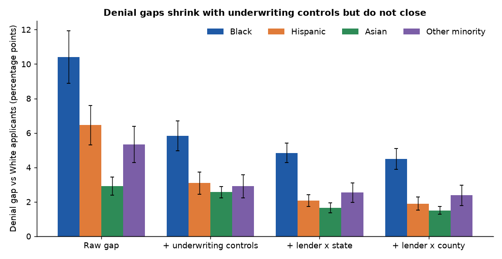
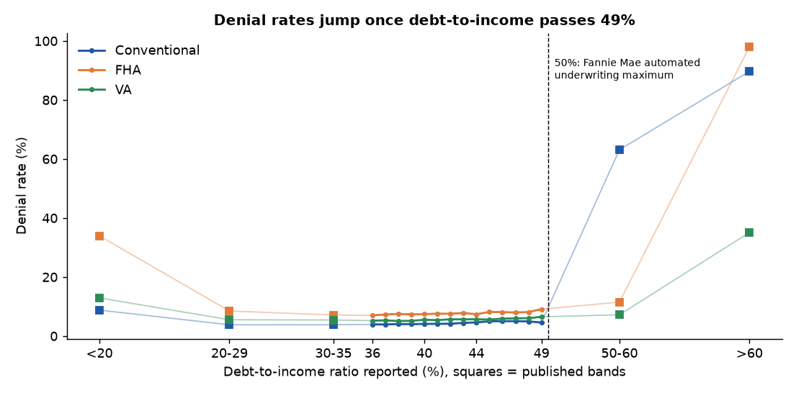
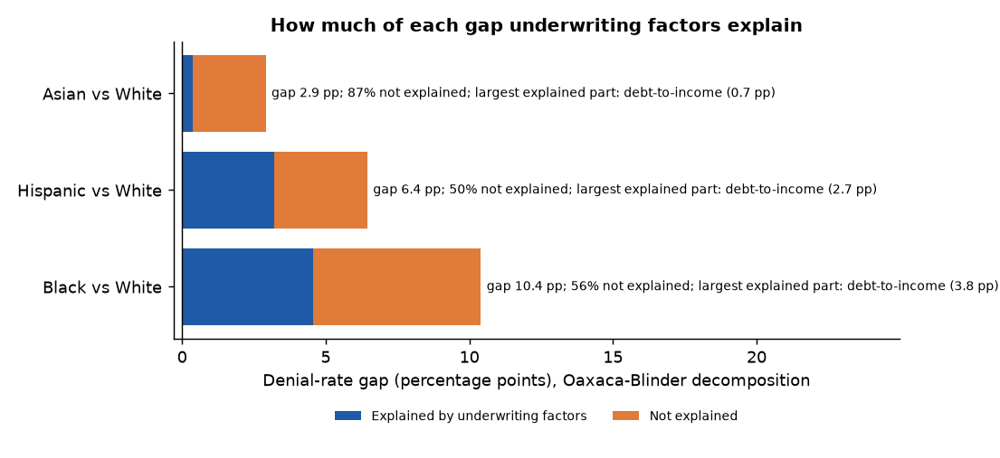
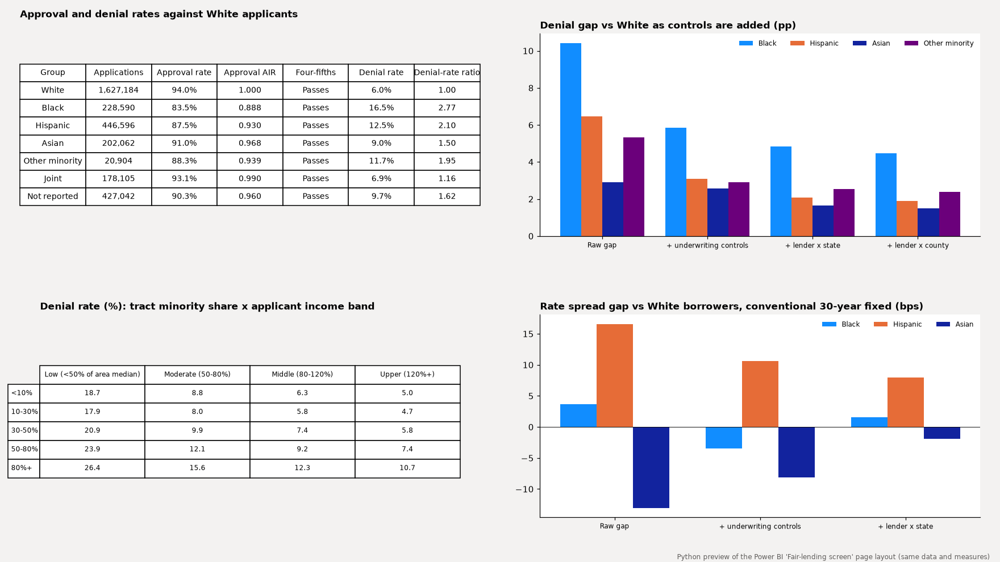

# Mortgage Approval and Fair-Lending Analysis (HMDA 2025)

**Who gets turned down for a home-purchase mortgage, why, and how much of the gap between groups is left after
underwriting factors are accounted for?** This project runs the screens a bank's fair-lending team runs on its
own HMDA data, on every 2025 U.S. home-purchase application that reached a decision (4,358,716
records; 3,139,327 applications to 2,568 lenders in the core sample). It ends with an Excel simulator that tests a
credit-policy change for disparate impact before it goes live, and a Power BI report.

**Tools:** SQL (DuckDB: typed staging of 99 text columns, quality rules, grouping sets, unnest of denial
reasons, lender, state, county and tract views) · Python (pandas, NumPy, statsmodels, SciPy) · Statistics
(Wilson intervals, linear probability models with absorbed lender x county fixed effects and errors
clustered by lender, logit marginal effects with delta-method intervals, Oaxaca-Blinder decomposition) ·
Excel (policy simulator with formulas, data validation and four-fifths flags) · Power BI (TMDL model,
DAX, four-page PBIR report)



## Findings

1. **3,139,327 home-purchase applications reached a credit decision in 2025** in the core sample (first-lien, owner-occupied, site-built 1-4 unit homes; 72% of all 4,358,716 decided home-purchase applications reported under HMDA). 91.3% were approved and 8.7% denied; 2,787,322 loans closed for $1.13 trillion.
2. **Black applicants were denied 2.8 times as often as White applicants** (16.9% against 6.1%); Hispanic applicants 12.8% (2.1x) and Asian applicants 9.0% (1.5x). Every group still passes the four-fifths screen on approval rates (lowest ratio 0.89, Black), because approval rates near 90% make large denial gaps look small as approval ratios. Denial-rate ratios are the better screen here.
3. **Debt-to-income above 49% is close to an automatic denial for conventional loans.** The conventional denial rate is 4.6% at a reported DTI of 49% and 63.1% at 50-60% (90% above 60%), matching Fannie Mae's 50% maximum for automated underwriting; DTI is cited in 86% of those denials. FHA has no cliff at 50% (9.1% at 49%, 11.5% at 50-60%). 26% of Black and 22% of Hispanic applicants report DTI of 50% or more, against 10% of White applicants.
4. **Underwriting factors explain about half of the Black-White gap.** Adding DTI, loan-to-value, income, loan size, loan type, age, sex and neighbourhood income cuts the Black-White gap from 10.4 pp to 5.8 pp (44% explained) and the Hispanic gap from 6.4 pp to 3.1 pp. Comparing applicants at the same lender in the same county leaves 4.5 pp for Black applicants (95% CI 3.9 to 5.1), 1.9 pp for Hispanic and 1.5 pp for Asian applicants. A logit model on 600,000 applications gives the same picture (Black marginal effect 5.0 pp, odds ratio 2.17).
5. **The largest explained part is debt-to-income.** In the Oaxaca-Blinder decomposition it accounts for 3.8 pp of the 10.4 pp Black-White gap; debt-to-income accounts for 2.7 pp of the 6.4 pp Hispanic-White gap.
6. **Credit history is the factor HMDA cannot control for.** It is cited in 28% of denials of Black applicants and 18% of denials of White applicants. The public data has no credit scores, so part of the unexplained gap may be credit differences; a lender can close this question with its own score data, the public file cannot.
7. **Pricing: at the same lender in the same state, Hispanic borrowers pay 8.0 bps more (95% CI 6.1 to 9.8 bps)** than comparable White borrowers on 1,206,195 originated conventional 30-year fixed loans (rate spread over the average prime offer rate, controlling for points paid). Black borrowers pay about the same (+1.6 bps, 95% CI -1.4 to 4.6 bps); Asian borrowers pay 1.9 bps less (95% CI -3.6 to -0.1 bps).
8. **Neighbourhood: applications in tracts that are 80%+ minority are denied at 13.8%** against 6.6% in tracts under 10% minority. After applicant controls and lender x state effects the difference is 0.5 pp (95% CI 0.1 to 0.9): most of the raw gap comes from who applies there, and a small part is tied to the location.
9. **Lender screen: 64 of the 73 largest lenders show a Black-White denial gap whose 95% interval is above zero after controls and county effects**, and 48 show one for Hispanic applicants (median adjusted gaps 3.7 pp and 1.9 pp). These are screening results that point to files to review, not findings.
10. **A 44% DTI cap would remove 769,229 approvals (33.2%) and $302.2 billion of loans,** falling on 46.7% of Black and 45.9% of Hispanic approvals against 28.5% of White approvals. The Black approval-rate ratio would fall from 0.885 to 0.660, and Black, Hispanic and Other minority applicants would fall below the four-fifths screen.





## Recommendations for a lender's fair-lending team

1. Track denial-rate ratios and adjusted gaps every quarter next to the four-fifths approval ratio, which passes for every group even though Black applicants are denied 2.8 times as often.
2. Before any guideline change, run the Excel simulator: a 44% DTI cap removes 46.7% of Black approvals and an LTV cap at 95% removes 61.8%, against 28.5% and 27.3% for White applicants. Document a business need and a less discriminatory alternative for any cap that lowers a group's ratio.
3. Offer debt-payoff and loan-size counselling at application to applicants whose DTI is just above 49%, where conventional denial rates jump; FHA is an alternative product for many of them.
4. Rerun the gap ladder on internal data with credit scores and full DTI detail. The remaining gap after scores is the figure regulators examine; the public data stops one step short of it.
5. Review pricing exceptions and lender credits for Hispanic borrowers, where the rate-spread gap remains within lender and state.
6. Use the lender screen as a peer benchmark: lenders with an interval above zero should sample denied files of comparable Black, Hispanic and White applicants for review.

## Deliverables

| Deliverable | Where |
|---|---|
| Power BI project: TMDL model (9 tables, 5 relationships, 22 DAX measures), 4 report pages | `dashboards/powerbi/MortgageFairLending.pbip` |
| CSV extracts used by Power BI | `dashboards/powerbi/data/` |
| Excel underwriting policy and fair-lending simulator | `excel/underwriting_policy_fair_lending_model.xlsx` |
| Analysis notebook with outputs | `notebooks/hmda_fair_lending.ipynb` |
| One-page memo | `reports/memo.md` |
| SQL: load, typing, 16 quality rules, funnel, group rates, DTI profile, denial reasons, lenders, geography, policy grid | `sql/` |
| Result tables and figures | `reports/tables/`, `reports/figures/` |



The Power BI project was generated from code and its report files validate against Microsoft's published
PBIR JSON schemas. Power BI Desktop runs on Windows only, so the preview above is a Python rendering of the
Fair-lending screen page from the same CSVs. To open the real report on Windows: open
`MortgageFairLending.pbip` in Power BI Desktop, set the `DataFolder` parameter (Transform data > Edit
parameters) to the full path of `dashboards/powerbi/data/`, and click Refresh.

## How it works

1. **Warehouse** (`sql/01-03`): DuckDB loads the 4,358,716-row file as text, types every field
   ('NA' and 'Exempt' become NULL), labels applicant groups, bands DTI, LTV, income and tract
   characteristics, and runs 16 quality rules
   ([`docs/data_quality_log.md`](docs/data_quality_log.md)).
2. **Views** (`sql/04-14`): decision funnel, rates by group and loan type, denial by exact DTI, denial reasons,
   lender benchmark, state, county and tract views, the Power BI fact table and the Excel policy grid.
3. **Gap ladder** (`src/fairlending.py`, `src/stats.py`): denial on group indicators, then underwriting controls,
   then lender x state and lender x county fixed effects, on the 2,396,022 applications with every
   control (76% of the core sample). Errors clustered by lender.
4. **Checks on the gap**: logit average marginal effects on a 600,000-row random sample;
   Oaxaca-Blinder decomposition; pricing gaps on originated conventional 30-year fixed loans; neighbourhood
   gaps by tract minority share; within-lender gaps for the 73 largest lenders.
5. **Business tools**: Excel simulator over the group x DTI x LTV grid (Python twin in
   `fairlending.simulate_policy` gives the same numbers); Power BI model and report from `src/powerbi.py`.

Details: [`docs/methodology.md`](docs/methodology.md) · data dictionary: [`docs/data_dictionary.md`](docs/data_dictionary.md)

## Run it

```bash
python -m venv .venv && source .venv/bin/activate
pip install -r requirements.txt
make all        # download (1.7 GB), build warehouse, statistics, notebook, tests (about 10 minutes)
```

## Project structure

```
├── data/                 raw/ and processed/ (git-ignored); README with sources
├── sql/                  DuckDB SQL: load, typing, quality rules, analysis views, Power BI and Excel extracts
├── src/                  pipeline: data, statistics, fair-lending screens, figures, Excel, Power BI, report
├── notebooks/            executed analysis notebook
├── excel/                underwriting policy and fair-lending simulator
├── dashboards/powerbi/   .pbip project (SemanticModel + Report), CSV extracts, preview
├── reports/              results.json, memo, figures, tables
├── docs/                 methodology, data dictionary, data quality log
└── tests/                pytest suite
```

## Data

Home Mortgage Disclosure Act (HMDA) loan application register, 2025 filing year, published by the CFPB and
FFIEC. Downloaded from the HMDA Data Browser API (nationwide, loan purpose = home purchase, action taken =
originated, approved not accepted or denied): [ffiec.cfpb.gov/data-browser](https://ffiec.cfpb.gov/data-browser/).
Lender names come from the HMDA filers list for 2025 and county names from the Census Bureau's 2020 county
codes. No account is needed. Raw files are not stored in this repository.

## Assumptions and limits

* HMDA has no credit scores, assets or employment detail, and reports DTI in bands outside 36-49%. Adjusted gaps
  are screening statistics. They show where to look, not that discrimination occurred.
* 24% of core applications miss a control (mostly DTI or LTV) and are left out of the
  regressions; their denial rates are higher (see `reports/tables/model_frame_exclusions.csv`), so the regression
  sample has a lower denial rate (7.9%) than the core sample.
* Denied preapproval requests are reported under a separate action code and are not in this data; applications
  that went through preapproval show no denials and the preapproval flag is not used as a control.
* Applicant group follows HMDA's derived ethnicity and race fields: Hispanic applicants of any race form one
  group; the others are non-Hispanic. Joint applications with mixed groups and unreported race are shown but not
  compared.
* The Excel simulator gives the first-order effect of a cap: approved applicants above it are lost. Some would
  restructure the loan to fit, so losses are an upper bound. The revenue rate (100 bps) is an
  assumption to replace.
* Rate spread is measured against the average prime offer rate on the lock date, which HMDA does not publish, so
  the pricing comparison cannot control for the timing of the rate lock beyond the lender x state effect.
